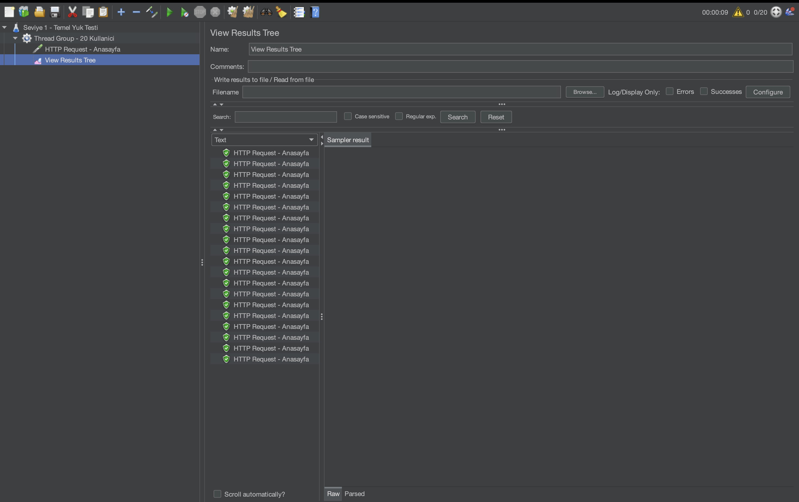
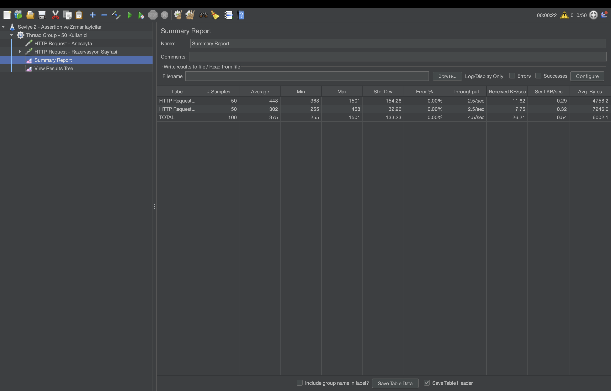
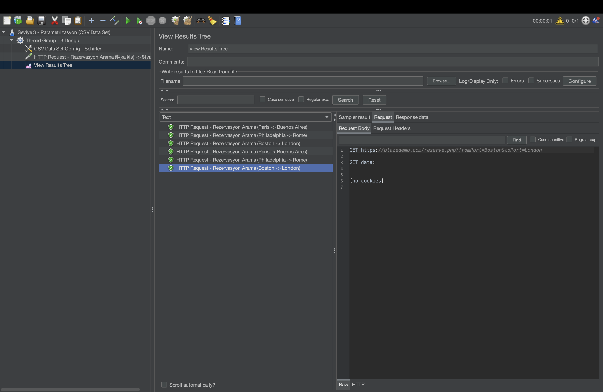

# BlazeDemo Performans ve Yük Testi Otomasyonu

Bu proje; **BlazeDemo** uçuş rezervasyon platformunun yüksek trafik altındaki davranışını, sistem kararlılığını, yanıt sürelerini (latency/response time) ve veri tutarlılığını ölçümlemek amacıyla geliştirilmiş kapsamlı bir **Apache JMeter** performans testi otomasyon paketidir.

---

## 📋 Proje Genel Bakışı

Modern web uygulamalarında kullanıcı deneyimini doğrudan etkileyen en kritik unsurlardan biri, eşzamanlı kullanıcı trafiği altında sunucu yanıt sürelerinin kabul edilebilir sınırlar içinde kalması ve veri akışının hatasız sürmesidir. 

Bu test paketi; tekil sayfa yük testlerinden başlayarak, gerçekçi kullanıcı hareketlerini (*think-time*), içerik doğrulama mekanizmalarını (*response assertions*) ve veri odaklı dinamik sorguları (*data-driven testing*) kapsayan uçtan uca bir performans doğrulama mimarisi sunar.

---

## 🏗️ Test Senaryoları ve Mimarisi

Test paketi 3 ana aşamadan ve modüler test planlarından oluşmaktadır:

```
├── sehirler.csv                  # Dinamik test veri seti (Data-Driven Test Data)
├── seviye1_kolay.jmx             # Senaryo 1: Temel Yük Testi Planı
├── seviye2_orta.jmx              # Senaryo 2: Akış, Zamanlayıcı & Assertion Test Planı
├── seviye3_zor.jmx               # Senaryo 3: Parametrik Dinamik Yük Test Planı
├── odev_tum_seviyeler.jmx        # Entegre Test Planı (Tüm senaryolar tek planda)
├── 1.png                         # Senaryo 1 Sonuç Ekran Görüntüsü
├── 2.png                         # Senaryo 2 Sonuç Ekran Görüntüsü
└── 3.png                         # Senaryo 3 Sonuç Ekran Görüntüsü
```

---

### 1. Senaryo: Temel Yük ve Kapasite Analizi (Baseline Load Test)

* **Amaç:** Hedef platformun (`blazedemo.com`) temel anasayfa trafiğinde eşzamanlı istekleri karşılama kapasitesini doğrulamak.
* **Trafik Profili:** 
  * **Kullanıcı Sayısı (Threads):** 20 Sanal Kullanıcı
  * **Ramp-Up Süresi:** 10 Saniye
  * **Döngü Sayısı (Loop Count):** 1
* **Protokol / Endpoint:** `HTTPS` / `GET /`
* **Dinleyici:** `View Results Tree`

#### Doğrulama ve Sonuç
20 eşzamanlı kullanıcının 10 saniyelik kademeli artışla sisteme dahil olduğu test sonucunda tüm istekler başarıyla tamamlanmış, HTTP 200 yanıt kodu alınmış ve herhangi bir bağlantı kopması yaşanmamıştır.



---

### 2. Senaryo: Çok Adımlı Kullanıcı Akışı, Düşünme Payı ve Yanıt Doğrulama (User Journey & Assertion)

* **Amaç:** Kullanıcıların ardışık sayfalar arasındaki geçişlerini, gerçek kullanıcı bekleme sürelerini (*Think Time*) simüle etmek ve dönen sayfa içeriğinin doğruluğunu garanti altına almak.
* **Trafik Profili:**
  * **Kullanıcı Sayısı (Threads):** 50 Sanal Kullanıcı
  * **Ramp-Up Süresi:** 20 Saniye
  * **Döngü Sayısı (Loop Count):** 1
* **İstek Akışı:**
  1. `GET /` (Anasayfa ziyareti)
  2. `Constant Timer` (2000 ms - Kullanıcının sayfayı inceleme / düşünme süresi)
  3. `GET /reserve.php` (Uçuş rezervasyon listeleme sayfası)
* **Response Assertion (Veri Doğrulama):**
  * Rezervasyon sayfası yanıt gövdesinde `"Virgin America"` havayolu bilgisinin varlığı doğrulanır.
* **Dinleyiciler:** `Summary Report`, `View Results Tree`

#### Doğrulama ve Sonuç
50 eşzamanlı sanal kullanıcı akışı boyunca sistem yanıt süreleri kararlı kalmış, tüm doğrulamalar başarıyla geçmiş ve **%0 Hata Oranı (Error Rate: 0.00%)** elde edilmiştir.



---

### 3. Senaryo: Veri Odaklı Dinamik Rota Sorgulama (Data-Driven CSV Parametrization)

* **Amaç:** Sabit sorgular yerine gerçek dünya kullanımını yansıtacak şekilde farklı kalkış ve varış rotalarının dinamik olarak sisteme gönderilmesini sağlamak.
* **Veri Kaynağı (`sehirler.csv`):**
  ```csv
  kalkis,varis
  Paris,Buenos Aires
  Philadelphia,Rome
  Boston,London
  ```
* **Yapılandırma:**
  * **CSV Data Set Config:** `sehirler.csv` dosyasından `${kalkis}` ve `${varis}` değişkenleri dinamik olarak okunur.
  * **HTTP Request:** `/reserve.php` uç noktasına `fromPort` ve `toPort` parametreleri dinamik değişkenlerle iletilir.
  * **Döngü Yapısı:** 3 iterasyon ile listedeki tüm şehir kombinasyonları sırayla yürütülür.
* **Dinleyici:** `View Results Tree`

#### Doğrulama ve Sonuç
CSV veri setinden okunan şehir çiftleri istek parametrelerine dinamik olarak enjekte edilmiş; *Paris -> Buenos Aires*, *Philadelphia -> Rome* ve *Boston -> London* sorguları ayrı ayrı başarıyla yürütülmüştür.



---

## ⚙️ Kurulum ve Çalıştırma Rehberi

### Gereksinimler
* Java JDK 11 veya üzeri
* Apache JMeter 5.6+

### 1. GUI Modunda Çalıştırma (İnceleme ve Hata Ayıklama)
Test planlarını grafik arayüzde açıp incelemek için:

```bash
# JMeter arayüzünü başlatın
jmeter

# İlgili .jmx dosyasını arayüzden açın (File -> Open)
# veya doğrudan komut satırından açın:
jmeter -t odev_tum_seviyeler.jmx
```

### 2. CLI / Non-GUI Modunda Çalıştırma (Önerilen Yöntem)
Yüksek yük testlerinde donanım kaynaklarını optimize etmek ve gerçekçi performans sonuçları elde etmek için testlerin komut satırından çalıştırılması önerilir:

```bash
# Senaryo 1 Yürütme
jmeter -n -t seviye1_kolay.jmx -l sonuclar_senaryo1.csv

# Senaryo 2 Yürütme
jmeter -n -t seviye2_orta.jmx -l sonuclar_senaryo2.csv

# Senaryo 3 Yürütme
jmeter -n -t seviye3_zor.jmx -l sonuclar_senaryo3.csv
```

### 3. HTML Dashboard Raporu Üretme
JMeter'ın yerleşik HTML analiz paneli ile interaktif grafikler üretmek için:

```bash
jmeter -n -t odev_tum_seviyeler.jmx -l sonuclar.csv -e -o ./rapor_dashboard
```

---

## 📊 Özet Değerlendirme ve Temel Metrikler

| Metrik | Senaryo 1 | Senaryo 2 | Senaryo 3 |
| :--- | :--- | :--- | :--- |
| **Sanal Kullanıcı (VUsers)** | 20 | 50 | 1 (3 İterasyon) |
| **Ramp-Up Süresi** | 10 sn | 20 sn | 1 sn |
| **Think Time** | Yok | 2000 ms | Yok |
| **Assertion Kuralı** | Yok | Text: "Virgin America" | Yok |
| **Veri Entegrasyonu** | Statik | Statik | Dinamik (CSV Data Set) |
| **Hata Oranı (Error %)** | **%0.00** | **%0.00** | **%0.00** |
| **Durum** | Başarılı | Başarılı | Başarılı |
